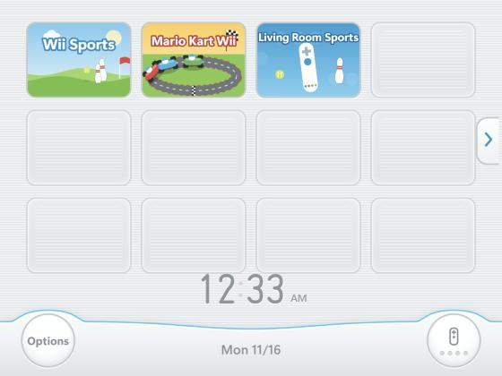
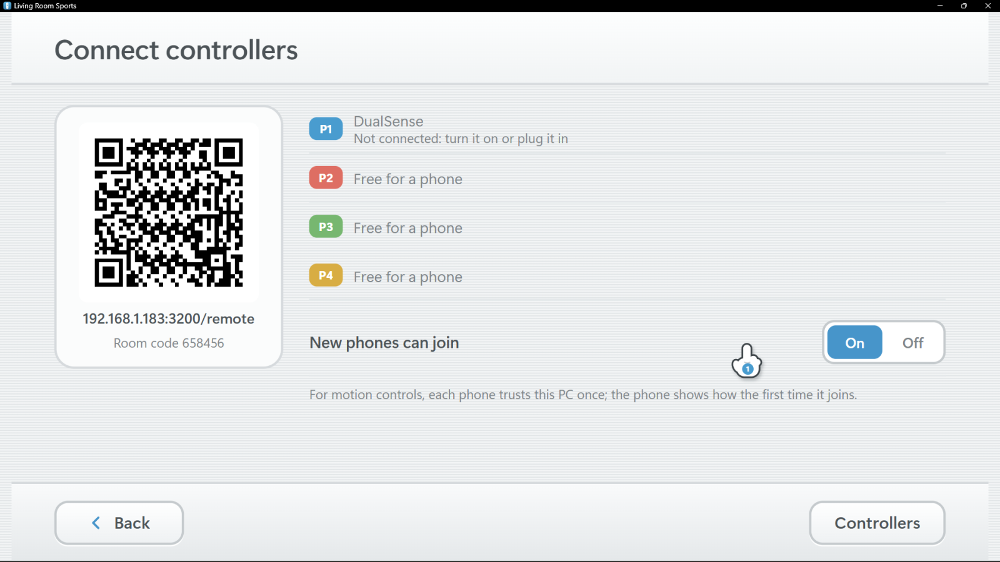
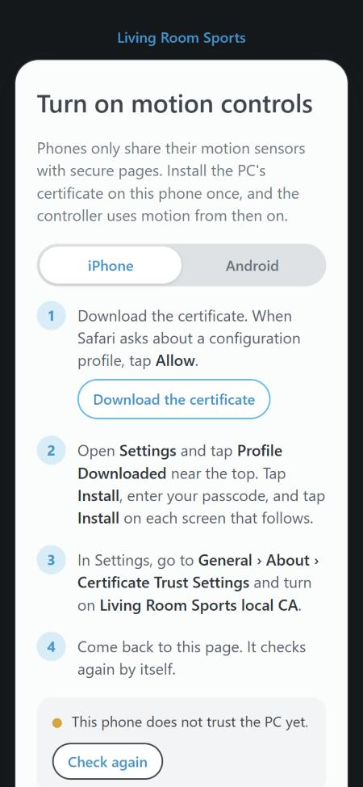

# Verification report

16 to 18 November 2026, on the development PC (Windows 11, Microsoft Edge, Node.js 22.23.4).

## In short

- **Automated checks:** all 142 tests pass (`python check.py`).
- **Installed build:** the portable build in `dist` ran end to end on this PC. It used its own Node.js, opened the Wii Menu in its own window and started Bowling. It stopped the game cleanly, and closing the window shut everything down.
- **Not yet checked:** playing with real controllers. The real Dolphin has started Mario Kart Wii, Super Smash Bros. Brawl and the 2-in-1 Wii Sports + Wii Sports Resort disc on this PC, but nothing has been played with a physical phone or a DualSense. [Still to check](#still-to-check-on-real-hardware) lists exactly what to try.

## How it was tested

- **A stand-in Dolphin** (`tests/fixtures/StubDolphin.cs`, built by `tests/fixtures/make-test-console.ps1`). It records the command line it was given and writes a Dolphin-style log into the user folder it was handed. It closes like Dolphin when asked, and with `LRS_STUB_CRASH=1` it crashes with Windows' access-violation code two seconds in.
- **Small disc images** carrying only real headers (game ID, Wii magic word, internal name) for Wii Sports, Wii Sports Resort, the 2-in-1 disc of both, Mario Kart Wii and Super Smash Bros. Brawl.
- **A throwaway settings folder**, so this PC's real `%LOCALAPPDATA%\LivingRoomSports` and any real Dolphin folder were never touched.
- **The in-app browser**, at 1280×720 (16:9), 1024×768 (4:3) and phone size (375×812), for the Wii Menu and the phone pages.
- **The real launcher**, `dist\Living Room Sports\Living Room Sports.exe`, driving a real Edge window.

## Results

| Requirement | How it was checked | Result |
| --- | --- | --- |
| 4×3 paged channel grid with animated tiles and empty slots | In-app browser at 16:9 and 4:3 | Works |
| Bottom bar with Wii Options and the clock and date | Same | Works |
| Pointer with hover, focus, select and cancel feedback | Mouse and keyboard in the browser | Works. Sounds are generated in the page; their calls were checked, not listened to |
| Channel preview with Wii Menu and Start | Opened each channel | Works |
| Correct at 16:9 and 4:3; pointer aligned on resize and full screen | Measured the hand's fingertip against the cursor before and after switching 16:9 → 4:3 | Works, after a fix (below). Full screen takes the same path as a resize but was not run in the test browser |
| First-run setup: Dolphin, games, recognised titles, controller test | Walked all six steps with the stand-in | Works |
| Exact next steps when something is missing | Tests for each missing-piece case; the stand-in with each piece removed | Works |
| Never label a preview as playable | Tests and channel previews with games missing | Works |
| Mario Kart Wii: native modes, DualSense layout, keyboard fallback, on-screen bindings | Channel tabs in the browser; tests of the profiles written for Dolphin | Works. The profiles are untested in a real Dolphin |
| One Wii Sports channel: 15 sports, 17 entries, Bowling and Golf once each with two editions | Tests of the catalogue; selector in the browser | Works |
| Direct entry only where verified, otherwise the shortest menu path | Dolphin cannot choose a sport inside a disc, so no entry claims direct entry; each one shows its path | Works. The paths follow the manuals and are unverified on real discs |
| Returning restores the previous selection | Launched, closed, reopened | Works |
| Control profiles: mouse and stick navigation, test screen, remapping, dead zones, reconnects | Mouse and keyboard in the browser; tests of the gamepad code | Works with mouse and keyboard. No DualSense was connected |
| Per-activity Wii Remote, Nunchuk and MotionPlus requirements | Catalogue tests; selector entries | Works |
| Resort started from the 2-in-1 disc's own menu | The real disc (SP2P01) started in the real Dolphin with the plan for a Wii Sports Tennis launch: four Wii Remotes with MotionPlus and nothing plugged into it, nothing in Dolphin's log, and the disc's *Which game would you like to play?* menu on screen. Tests of the plan and of a launch from the disc | Works, after a fix (below). Resort's sports not yet reached with the new setup |
| Missing files, disconnects, launch failures and crashes | Tests for each; the stand-in crashing on demand | Works: each reports what happened and what to do |
| Emulator settings and saves preserved | Tests that write and then restore Dolphin's settings, including after an interrupted run | Works on the stand-in's user folder |
| Phone controls, including gyro motion | The real phone page run in a fake browser (23 tests) and its motion maths (6 tests); layouts viewed at phone size | Works in tests. No physical phone was used |
| No zoom when a button is tapped twice | Tests of the page's viewport and its touch and gesture handling | Works in tests. No physical phone was used |
| Phones choose from the free players; a returning phone gets its own back | Server tests with several phones, including one that drops and returns and one that tries a player just taken. The real server with two phone pages in the browser: one chose Player 2, and the other's list dropped it at once | Works |
| Phones join while a game runs | The stand-in running Tennis: a second phone joined from the code on Now playing and got the Tennis controls at once. The ⋯ › Add a player code viewed at phone size, and Now playing at 16:9 and 4:3 | Works with the stand-in. Not yet tried in a real game |
| Two, three and four phones stay responsive | Four phones sending at full rate through the real server and motion bridge to a stand-in that reads them as Dolphin does: under 3 ms from phone to Dolphin at worst. Then a simulated Wi-Fi that carries only 40 messages a second, shared by two phones: the old way fell 1.1 seconds behind and kept falling; the new way stays within 62 ms | Works in tests. Not yet tried with real phones on a busy Wi-Fi |
| Phone motion over HTTPS | Tests of the setup page and certificate download; both setups viewed at phone size | Works in tests. Installing the certificate on a real phone is unverified |
| Installed build tested; portable build delivered | Ran the portable build; launcher tests build and run it with its own Node.js | Works |
| Games open on the chosen screen and move between screens | Real Dolphin, full screen and borderless, running a tiny test program from a throwaway user folder: its window was moved from this PC's 1920 × 1080 main screen to its 2560 × 1600 screen at 200% and back. Then the real server with the stand-in: Game screen, Move to the other screen, and the phone's ⋯ menu | Works. Dolphin opens a small window and goes full screen a moment later on whichever screen it is on, so the move lands either way |
| Phones recenter on the game's new screen | The real phone page in a fake browser; the console and server tests follow which screen the game is on. The prompt viewed at phone size, upright and in landscape, against a stand-in console | Works in tests. No physical phone was used |
| A game moved while Dolphin goes full screen still fills its screen | Real Dolphin with Mario Kart Wii, moved to the second screen 600, 900 and 1200 ms after its window appeared; tests of the helper's report and of the console putting a stuck window right | Works, after a fix (below) |
| Super Smash Bros. Brawl channel | The real disc's header read as RSBE01. The real Dolphin started it with the console's launch plan (a GameCube controller in port 1, a Wii Remote and Nunchuk for a phone) and reached the wrist-strap reminder and then the save-file prompt, full screen, with nothing in Dolphin's log. The channel, its tabs and Now playing viewed with the stand-in | Works. Not yet played with a controller |
| Games drawn at the screen's resolution | Launch settings test; the setting checked against Dolphin's source, which picks the smallest whole multiple of the Wii's picture that covers the window and recalculates when the window changes size | Set. Not yet looked at with a disc |
| Home › Wii Menu in a game returns to the Wii Menu | Real Dolphin, with the console's logger settings, wrote its warning to `Logs\dolphin.log` without a pop-up. The real server closed the stand-in within a second of the Wii Menu request appearing in its log | Works. Not yet tried from a real disc's HOME menu |

## Screens

The Wii Menu at 16:9 and 4:3. The grid keeps four columns and three rows; at 4:3 the tiles grow taller rather than the page being letterboxed.

The installed build's own window, opened by the launcher, on the Connect controllers screen:

The phone setup page, which opens on Android steps for an Android phone, and the iPhone steps:

## Problems found and fixed while verifying

- **An error message after every game.** When a game ended, the server asked the launcher to bring the Wii Menu forward with an option the launcher did not have, so it showed *Unknown option: --focus*. The launcher now has `--focus`. Run that way, it never shows a message or starts anything.
- **Dolphin could open behind the Wii Menu.** Windows does not let a background program like the server bring a window forward. The launcher now does it for Dolphin's window when a game starts, and for the Wii Menu when it ends.
- **Closing the Wii Menu during a game cut the game off.** Now the server stays up for the game's controllers, and the Wii Menu comes back when the game ends.
- **The mouse hand drifted after a resize.** After the window changed shape, the hand sat up to 40 pixels from the cursor until the mouse moved. It now goes straight back under the cursor.
- **The server could stop while Dolphin's settings were being put back.** The game now counts as running until that restore has finished.
- **Phones were offered a VirtualBox address** that they could never reach. Phones now see only addresses on a routed network.
- **A crash report showed the previous session's log.** It now shows only the log written by the run that crashed.
- **A destructive dialog started on its confirm button.** It now starts on Cancel.
- **A game ending mid-transition could leave Now playing stuck on screen.** Screen changes are now made one at a time.
- **A game could be left small and frameless.** A move that landed while Dolphin was switching to full screen put the window back to the size it was being moved at, so the game sat in a small box with no title bar. The console now stops setting the window's place once Dolphin changes its style, and makes a frameless window that does not fill its screen fill it.
- **Resort said a Wii Remote had no MotionPlus.** The 2-in-1 disc opens on a menu that starts either game, whichever channel launched it. A Wii Sports launch gave each Wii Remote a Nunchuk and no MotionPlus, so Resort's Table Tennis turned them away. With that disc, every Wii Remote now has MotionPlus, which Wii Sports ignores, and a Nunchuk only for a sport that uses one.
- **Phones could not open the QR code's link.** Windows Firewall allowed Node.js on Public networks only, the answer its prompt had been given, and this PC's Wi-Fi had become a Private network. So Windows dropped every phone's connection while everything still worked from the PC. The console now asks Windows which kind of network the PC is on and whether the firewall lets its own `node.exe` in there. It asks when it starts and when Connect controllers opens. If the firewall turns phones away, that screen names the network and the box to tick, and opens Windows' list of allowed apps. The check was run against this PC's real firewall, and the screen was viewed at 16:9 and 4:3 with the block reported and after Check again.
- **Any device on the Wi-Fi could get the room code.** A security review before publishing found that `/config` gave the room code to whoever asked, and that wrong codes could be tried without limit. Together these meant anyone on the same network could join as a player. Another device could also open the arcade's view of every phone's input. Now `/config` gives the code only to the PC itself. A phone carries the code from the QR code to the motion setup page and back. Five wrong codes in a minute from one address make it wait, and the arcade, like the Wii Menu, only opens on the PC. A test plays the stranger, with connections that look like they come from another device. The review also checked the console's control API, which answers only the PC, needs the PC's own address and a custom header, and so cannot be called from websites; how text from phones is shown, which is always plain text; the file dialogs and screen helper, which pass paths as environment variables, never inside script; and the motion bridge to Dolphin, which listens only on the PC. All were sound.
- **A second phone lagged and stuttered.** Phones sent their controls 60 times a second and the PC never answered. A phone can hold back a small message until its last one is acknowledged, and Windows waits up to 200 ms before acknowledging data it has nothing to reply to, so a phone's movements arrived in bursts. And when the Wi-Fi could not carry every phone's updates, they queued, so a phone played back movements from a second or more before. Now the PC answers every update at once. A phone keeps at most two updates unanswered, and when the Wi-Fi is busy it waits and then sends only its newest state. A phone held still repeats its state four times a second instead of up to 60, which leaves more of the Wi-Fi for the others.
- **A Wi-Fi stall could disconnect a phone.** The server dropped any connection that had more than 16 KB waiting, so the burst of updates that arrives after a stall looked like an attack. Now only a single message that is too large is refused.
- **Tapping a button twice zoomed the phone's page.** A quick double tap on A or B zoomed in and pushed the controls off the screen. The page now turns zooming off, along with Safari's double-tap and pinch gestures.

## Still to check on real hardware

1. **Dolphin with your discs.** Start each channel and play a little of each. Check that the controls in the on-screen tables do what they say, and check two or three menu paths.
2. **A phone.** Join, then install the certificate: iPhone in Safari, Android in Chrome. In Bowling, check that turning the phone right moves the pointer right and that a swing throws. In Mario Kart Wii, check that tilting steers. With two to four phones, check that every phone answers at once and that each was offered only free players. During a game, join one more phone from the code on Now playing.
3. **A DualSense over USB and Bluetooth.** Check Wii Menu navigation, the Controllers › Test tab, the gyro pointer in a sport, and that it reconnects after being turned off and on.
4. **From the shortcut.** Start a game and check that Dolphin comes to the front and that the Wii Menu comes back after you quit the game.
5. **Two screens with a disc.** Set **Wii Options › Dolphin › Game screen** to the second screen, start Wii Sports and check that it fills that screen and looks sharp rather than soft. Press **Move to the other screen**. On a phone, point at the game and tap **Recenter**: the pointer should be in the middle of the game. Then press Home in the game and choose Wii Menu: the Wii Menu should come back.
6. **Wii Sports Resort.** Start Golf and check that no message about the extension appears; start Archery and check that the Nunchuk works. With the 2-in-1 disc, also start Tennis, choose Wii Sports Resort on the disc's menu and start Table Tennis: no message about MotionPlus should appear.
7. **Super Smash Bros. Brawl.** Start a Brawl with a DualSense and a phone. Check that the DualSense plays as a GameCube controller (✕ attacks, △ jumps) and that the phone's stick moves its fighter and C jumps.
