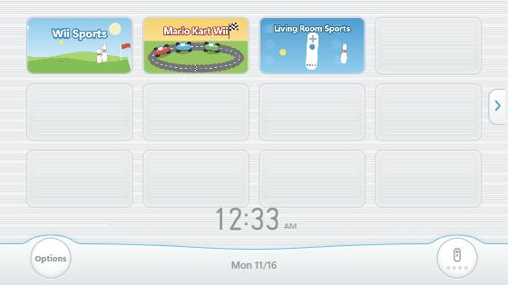
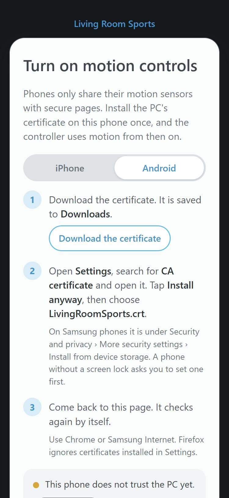

# Verification report

16 November 2026, on the development PC (Windows 11, Microsoft Edge, Node.js 22.23.4).

## In short

- **Automated checks:** all 104 tests pass (`python check.py`).
- **Installed build:** the portable build in `dist` ran end to end on this PC. It used its own Node.js, opened the Wii Menu in its own window and started Bowling. It stopped the game cleanly, and closing the window shut everything down.
- **Not yet checked:** real hardware. Nothing here has run against real Dolphin with real discs, a physical phone or a DualSense. [Still to check](#still-to-check-on-real-hardware) lists exactly what to try.

## How it was tested

- **A stand-in Dolphin** (`tests/fixtures/StubDolphin.cs`, built by `tests/fixtures/make-test-console.ps1`). It records the command line it was given and writes a Dolphin-style log into the user folder it was handed. It closes like Dolphin when asked, and with `LRS_STUB_CRASH=1` it crashes with Windows' access-violation code two seconds in.
- **Small disc images** carrying only real headers (game ID, Wii magic word, internal name) for Wii Sports, Wii Sports Resort and Mario Kart Wii.
- **A throwaway settings folder**, so this PC's real `%LOCALAPPDATA%\LivingRoomSports` and any real Dolphin folder were never touched.
- **The in-app browser**, at 1280×720 (16:9), 1024×768 (4:3) and phone size (375×812), for the Wii Menu and the phone pages.
- **The real launcher**, `dist\Living Room Sports\Living Room Sports.exe`, driving a real Edge window.

## Results

| Requirement | How it was checked | Result |
| --- | --- | --- |
| 4×3 paged channel grid with animated tiles and empty slots | In-app browser at 16:9 and 4:3 | Works |
| Bottom bar with Wii Options and the clock and date | Same | Works |
| Pointer with hover, focus, select and cancel feedback | Mouse and keyboard in the browser | Works. Sounds are generated in the page; their calls were checked, not listened to |
| Channel preview with Wii Menu and Start | Opened each channel | Works |
| Correct at 16:9 and 4:3; pointer aligned on resize and full screen | Measured the hand's fingertip against the cursor before and after switching 16:9 → 4:3 | Works, after a fix (below). Full screen takes the same path as a resize but was not run in the test browser |
| First-run setup: Dolphin, games, recognised titles, controller test | Walked all six steps with the stand-in | Works |
| Exact next steps when something is missing | Tests for each missing-piece case; the stand-in with each piece removed | Works |
| Never label a preview as playable | Tests and channel previews with games missing | Works |
| Mario Kart Wii: native modes, DualSense layout, keyboard fallback, on-screen bindings | Channel tabs in the browser; tests of the profiles written for Dolphin | Works. The profiles are untested in a real Dolphin |
| One Wii Sports channel: 15 sports, 17 entries, Bowling and Golf once each with two editions | Tests of the catalogue; selector in the browser | Works |
| Direct entry only where verified, otherwise the shortest menu path | Dolphin cannot choose a sport inside a disc, so no entry claims direct entry; each one shows its path | Works. The paths follow the manuals and are unverified on real discs |
| Returning restores the previous selection | Launched, closed, reopened | Works |
| Control profiles: mouse and stick navigation, test screen, remapping, dead zones, reconnects | Mouse and keyboard in the browser; tests of the gamepad code | Works with mouse and keyboard. No DualSense was connected |
| Per-activity Wii Remote, Nunchuk and MotionPlus requirements | Catalogue tests; selector entries | Works |
| Missing files, disconnects, launch failures and crashes | Tests for each; the stand-in crashing on demand | Works: each reports what happened and what to do |
| Emulator settings and saves preserved | Tests that write and then restore Dolphin's settings, including after an interrupted run | Works on the stand-in's user folder |
| Phone controls, including gyro motion | The real phone page run in a fake browser (15 tests) and its motion maths (4 tests); layouts viewed at phone size | Works in tests. No physical phone was used |
| Phone motion over HTTPS | Tests of the setup page and certificate download; both setups viewed at phone size | Works in tests. Installing the certificate on a real phone is unverified |
| Installed build tested; portable build delivered | Ran the portable build; launcher tests build and run it with its own Node.js | Works |

## Screens

The Wii Menu at 16:9 and 4:3. The grid keeps four columns and three rows; at 4:3 the tiles grow taller rather than the page being letterboxed.

The installed build's own window, opened by the launcher, on the Connect controllers screen:

The phone setup page, which opens on Android steps for an Android phone, and the iPhone steps:

## Problems found and fixed while verifying

- **An error message after every game.** When a game ended, the server asked the launcher to bring the Wii Menu forward with an option the launcher did not have, so it showed *Unknown option: --focus*. The launcher now has `--focus`. Run that way, it never shows a message or starts anything.
- **Dolphin could open behind the Wii Menu.** Windows does not let a background program like the server bring a window forward. The launcher now does it for Dolphin's window when a game starts, and for the Wii Menu when it ends.
- **Closing the Wii Menu during a game cut the game off.** Now the server stays up for the game's controllers, and the Wii Menu comes back when the game ends.
- **The mouse hand drifted after a resize.** After the window changed shape, the hand sat up to 40 pixels from the cursor until the mouse moved. It now goes straight back under the cursor.
- **The server could stop while Dolphin's settings were being put back.** The game now counts as running until that restore has finished.
- **Phones were offered a VirtualBox address** that they could never reach. Phones now see only addresses on a routed network.
- **A crash report showed the previous session's log.** It now shows only the log written by the run that crashed.
- **A destructive dialog started on its confirm button.** It now starts on Cancel.
- **A game ending mid-transition could leave Now playing stuck on screen.** Screen changes are now made one at a time.

## Still to check on real hardware

1. **Dolphin with your discs.** Start each channel and play a little of each. Check that the controls in the on-screen tables do what they say, and check two or three menu paths.
2. **A phone.** Join, then install the certificate: iPhone in Safari, Android in Chrome. In Bowling, check that turning the phone right moves the pointer right and that a swing throws. In Mario Kart Wii, check that tilting steers.
3. **A DualSense over USB and Bluetooth.** Check Wii Menu navigation, the Controllers › Test tab, the gyro pointer in a sport, and that it reconnects after being turned off and on.
4. **From the shortcut.** Start a game and check that Dolphin comes to the front and that the Wii Menu comes back after you quit the game.
